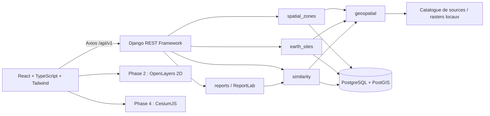

# Architecture Earth-Space Analog Finder

Cette architecture couvre le projet complet. Le code livré à ce stade implémente la phase 1 : environnement Python 3.12, Django REST Framework, PostGIS, React, diagnostics et documentation OpenAPI. Les modèles métier et les traitements scientifiques seront ajoutés progressivement après validation de chaque phase.

La validation du frontend est réussie. Les verrous Python, la construction backend et les tests PostGIS restent à terminer : les téléchargements PyPI, Debian et Docker Hub ont rencontré des expirations. Le script de setup inclut la reprise de génération des verrous ; les résultats effectivement obtenus sont détaillés dans `VALIDATION.md`.

## Lecture des spécifications

Le document Word présente une recherche d’analogues pour Mars et la Lune, trois objectifs de test (rover, habitat et ISRU), un vecteur environnemental, un comparateur et un rapport PDF. Le diagramme fourni décrit la sélection d’un polygone, sa validation, la consultation des caractéristiques, la sélection des candidats terrestres, le calcul du score, le tri, les détails d’un site et la génération du PDF.

La demande textuelle précise le périmètre et les contraintes d’implémentation. Elle fait autorité pour le choix Django/React, Python 3.12, le travail par phases, l’absence de données fictives et le report du deep learning. La rédaction du PDF sera déterministe avec ReportLab ; un service de génération de texte n’est pas nécessaire au MVP. Les pourcentages cités à titre d’exemple dans le document Word ne sont pas des résultats à reproduire.

Deux cas du diagramme nomment le même lancement de recherche ; ils correspondent à une seule opération métier. Les relations « include » se traduisent par des étapes obligatoires dans les services backend. Le contrôle de validité d’une zone doit également être imposé par l’API. Une flèche dans le diagramme ne suffit pas comme validation. La Lune est ajoutée conformément au Word et à la demande, même si le diagramme ne nomme que Mars.

## Composants



Le backend possède les règles scientifiques, les validations et la persistance. Le frontend reçoit des données structurées et les présente. Aucun calcul de score de référence n’est délégué au navigateur. Les rasters sont conservés sur disque avec leur empreinte SHA-256 ; PostGIS conserve les emprises et les métadonnées, sans charger systématiquement les rasters en base.

## Arborescence

```text
Naza/
  backend/
    config/                 settings, URLs, diagnostics, exceptions, tests
    spatial_zones/          zones d’étude Mars/Lune (phase 2)
    earth_sites/            catalogue de candidats terrestres (phase 2)
    geospatial/             sources, extraction, qualité et référentiels (phase 2)
      migrations/           activation PostGIS dès la phase 1
    similarity/             analyses et classements versionnés (phase 3)
    reports/                export ReportLab (phase 5)
    requirements*.in        contraintes de dépendances
    requirements*.txt       générés au premier setup réussi, versions et empreintes
    Dockerfile              Python 3.12 dans /opt/venv, bibliothèques SIG
  frontend/
    src/api/                client Axios et contrats TypeScript
    src/hooks/              diagnostics annulables
    src/App.tsx             accueil et routes des pages prévues
    src/styles.css          Tailwind et styles responsive
    package-lock.json       verrou npm
  data/raw/                 téléchargements originaux, ignorés par Git
  data/processed/           extraits et dérivés, ignorés par Git
  docs/                     architecture, données, dépendances et validation
  scripts/                  initialisation et contrôles PowerShell
  compose.yaml              PostgreSQL/PostGIS, backend, frontend optionnel
```

## Modèles prévus en phase 2 et suivantes

| Application | Modèle prévu | Champs et responsabilités |
| --- | --- | --- |
| `spatial_zones` | `SpatialZone` | UUID, nom, astre, polygone, référentiel, convention de longitude, date, état de validation |
| `earth_sites` | `EarthSite` | UUID, nom, pays, point/emprise WGS84, description sourcée |
| `geospatial` | `Dataset` | fournisseur, produit/version, URL, licence, date d’accès, checksum, astre, CRS, unités, résolution, nodata, emprise, fichier local |
| `geospatial` | `FeatureObservation` | région, caractéristique, valeur nullable, unité, méthode/version, résolution, source, couverture, qualité |
| `similarity` | `Analysis` | zone, objectif, état, horodatages, erreur structurée, caractéristiques utilisées, pondérations, normalisation et versions des sources |
| `similarity` | `AnalogueResult` | analyse, site, rang, score, distance, contributions, couverture des données |
| `reports` | `Report` | analyse et résultat choisis, date, version du modèle de rapport, fichier, checksum |

Les modèles Django `auth`, `sessions` et la migration PostGIS existent en phase 1. Aucun de ces modèles métier n’est prétendu livré avant la phase 2.

## Référentiels et validation géométrique

Pour la Terre, longitude/latitude WGS84 avec SRID 4326. Pour Mars et la Lune, utiliser un CRS planétaire documenté par le produit (IAU, WKT ou PROJJSON), son rayon/ellipsoïde et la convention des longitudes. Ne jamais étiqueter une géométrie martienne ou lunaire comme WGS84. Le champ spatial planétaire pourra utiliser SRID 0 avec WKT obligatoire, ou un SRID personnalisé explicitement enregistré et testé dans PostGIS. Ne jamais utiliser `geography`, `ST_Area` sphéroïdal terrestre ou une transformation vers WGS84 pour un autre astre.

OpenLayers doit disposer d’une projection planétaire explicite. Utiliser une projection équirectangulaire ou la projection du raster, sans appliquer le fond OSM ou Web Mercator à Mars/Lune. Dans Cesium, créer des scènes et ellipsoïdes distincts ; les ressources terrestres Cesium ne constituent pas des fonds planétaires. Le repli 2D est obligatoire lorsque le service, WebGL ou le relief sont absents.

L’API vérifiera : géométrie Polygon, anneau fermé, coordonnées finies dans les limites documentées, absence d’auto-intersection, surface et nombre de sommets bornés, intersection avec la couverture des données et cohérence de l’astre. Traiter explicitement l’antiméridien et les pôles ; rejeter avec un message clair les cas non pris en charge par le MVP. Les surfaces et distances exigent une projection métrique adaptée à l’astre. Ces règles seront testées en phase 2 avant l’ouverture des endpoints métier.

## Extraction et qualité scientifique

Une source utilisable doit avoir un identifiant, un fichier réellement téléchargé, une empreinte, un référentiel et des unités connues. Rasterio masque les nodata puis extrait les pixels valides dans le polygone. Les pentes et la rugosité exigent une résolution métrique connue et une méthode commune ; on ne calcule pas un gradient en degrés de longitude comme s’il s’agissait de mètres. Géopandas/Shapely assurent la préparation vectorielle, PyProj les transformations au sein du bon astre.

Une caractéristique absente reste absente : pas de température, d’albédo, de taille de blocs ni de minéralogie inventés à partir d’un simple DEM. Ne pas comparer les altitudes absolues de datums différents ; préférer le relief local et des descripteurs morphologiques communs. Afficher la couverture, la résolution et la méthode. L’amplitude thermique de surface et une température de l’air ERA5 ne sont pas interchangeables.

## Moteur de similarité prévu

1. Fixer un ensemble de caractéristiques comparables, documentées et disponibles pour la cible et les candidats. Une politique commune de caractéristiques évite de classer des candidats sur des bases différentes.
2. Ajuster une normalisation uniquement sur le jeu de référence terrestre versionné ; enregistrer ses paramètres. Signaler les valeurs hors de son domaine. Une colonne constante n’apporte aucune information et est exclue.
3. Appliquer des poids positifs selon l’objectif, puis les renormaliser sur les caractéristiques réellement utilisées. Les profils seront des paramètres méthodologiques versionnés, jamais présentés comme des constantes physiques.
4. Utiliser `sklearn.neighbors.NearestNeighbors` sur les vecteurs normalisés pondérés. Une convention possible est la distance euclidienne après multiplication par la racine des poids ; le score calculé `100 * exp(-distance)` est documenté, versionné et compris entre 0 et 100. Le calibrage final sera testé en phase 3.
5. Si la couverture ou le nombre de caractéristiques est insuffisant, renvoyer un état explicite sans score. Un objectif ISRU sans données minéralogiques ou habitat sans données pertinentes est indisponible, même si des DEM existent.
6. Conserver le score, la distance, les écarts par caractéristique, les données et versions de méthode. Départager les égalités de façon déterministe.

Ce score est un indicateur de similarité dépendant du jeu de référence et de la méthode. Il ne mesure pas une probabilité de réussite d’une mission. Les essais terrestres ne reproduisent pas la gravité, la pression ni les radiations extraterrestres. Le rapport le rappellera sans déduire ces propriétés d’une carte.

## Contrats REST

Endpoints livrés :

| Méthode | Chemin | Comportement |
| --- | --- | --- |
| GET | `/api/v1/health/` | Django et versions Python/Django ; fonctionne sans accès DB |
| GET | `/api/v1/ready/` | requête réelle `PostGIS_Version()`, HTTP 200 ou 503 |
| GET | `/api/v1/capabilities/` | phase courante et modules disponibles/prévus |
| GET | `/api/schema/` | schéma OpenAPI généré |
| GET | `/api/docs/` | Swagger UI avec ressources locales sidecar |

Contrats proposés, non implémentés en phase 1 :

| Phase | Méthode et chemin | Usage |
| --- | --- | --- |
| 2 | `GET /api/v1/datasets/` | sources, couverture et caractéristiques disponibles |
| 2 | `POST /api/v1/spatial-zones/` | créer et valider une zone et son astre |
| 2 | `GET /api/v1/spatial-zones/{id}/` | zone et observations réellement disponibles |
| 2 | `GET /api/v1/earth-sites/` et `/{id}/` | catalogue et détails sourcés |
| 3 | `POST /api/v1/analyses/` | analyse d’une zone validée avec objectif et paramètres |
| 3 | `GET /api/v1/analyses/{id}/` | état `pending/running/completed/failed` et erreurs |
| 4 | `GET /api/v1/analyses/{id}/results/` | résultats triés, paginés et géolocalisés |
| 5 | `POST /api/v1/analyses/{id}/reports/` | générer un PDF pour un résultat de cette analyse |
| 5 | `GET /api/v1/reports/{id}/download/` | télécharger le rapport autorisé |

Le MVP effectuera une petite analyse synchrone bornée en phase 3, avec état persisté ; aucun faux avancement chiffré. Ajouter une file de tâches seulement si les volumes mesurés l’exigent. Les erreurs de validation utilisent HTTP 400, une donnée absente HTTP 422 et un service indisponible HTTP 503. Les URLs et fichiers importés proviendront d’un catalogue administré, pas de chemins arbitraires fournis par le navigateur.

Les diagnostics sont publics sur localhost. Les autres endpoints suivront la permission DRF `IsAuthenticated` configurée par défaut ; leurs permissions et la propriété des analyses seront établies et testées avant leur livraison. CORS est limité aux origines locales déclarées. Aucun wildcard ou mot de passe n’est codé dans le frontend.

## Pages React

Les routes `/`, `/exploration`, `/recherche`, `/resultats`, `/comparaison`, `/rapport` sont prêtes. Seuls l’accueil et ses diagnostics sont fonctionnels en phase 1. Les autres routes expliquent leur disponibilité future et n’exposent aucune donnée fictive. Les prochaines phases déplaceront leurs composants dans des dossiers de fonctionnalités séparés.

La phase 2 ajoute OpenLayers et le dessin/édition de polygones. La phase 4 ajoute CesiumJS avec ressources locales Vite et chargement à la demande. Les vues sont synchronisées en orientation ou échelle de terrain lorsque cela a un sens ; ne pas réutiliser les mêmes coordonnées caméra entre astres.

## Rapport PDF prévu

ReportLab produit la zone cible, les coordonnées et leur référentiel, l’analogue sélectionné, le score et sa méthode, les caractéristiques et unités, les absences, les facteurs de similarité, les limites et les sources versionnées. Les recommandations seront conditionnées par l’objectif et les données disponibles. La logistique et l’accessibilité d’un site ne seront affirmées qu’avec des sources appropriées.

## Validation par phase

- Phase 1 : compilation frontend, appels HTTP, CORS autorisé/refusé, indisponibilité DB, vraie opération spatiale PostGIS, import des bibliothèques sous Python 3.12 et validation OpenAPI.
- Phase 2 : import réel vérifié par empreinte et emprise, géométries invalides, référentiels planétaires, nodata, unités, résolution et absence de couverture.
- Phase 3 : normalisation figée, poids, égalités, invariance du classement, absence de données, contrôles sur régions documentées ; ne pas transformer une intuition géologique en vérité terrain chiffrée.
- Phase 4 : sélection des résultats, carte terrestre, repli 2D, erreurs de sources externes et chargement des ressources Cesium.
- Phase 5 : cohérence rapport/résultat, génération et téléchargement PDF, rendu lisible et tests du parcours utilisateur complet.
